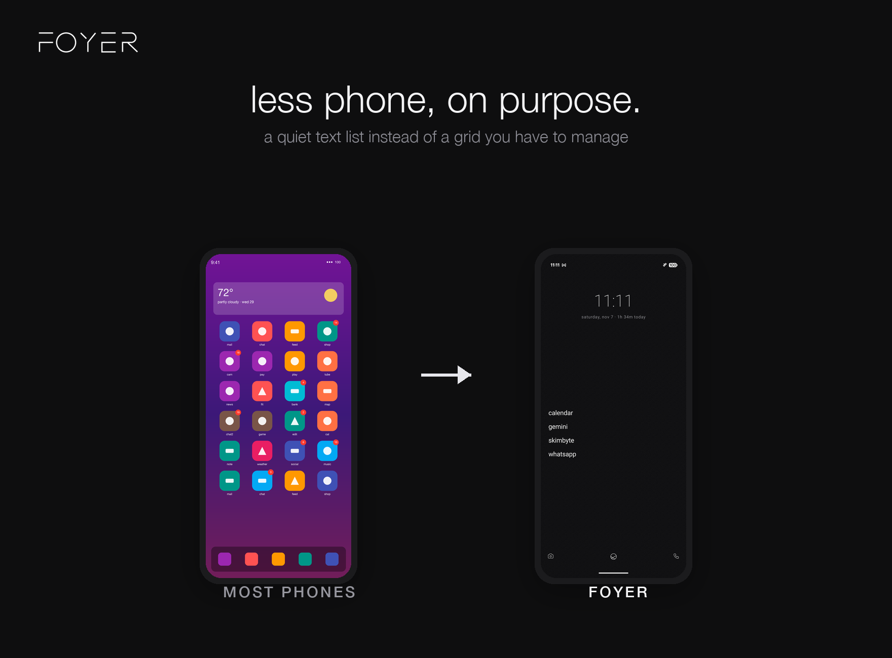

<p align="center">
  
</p>

<p align="center">
  a quiet, text-first Android launcher with a fully on-device AI assistant.<br/>
  <a href="https://foyerlauncher.com">foyerlauncher.com</a>
</p>

<p align="center">
  <a href="https://github.com/akshay2211/Foyer/actions/workflows/ci.yml"></a>
  <a href="LICENSE"></a>
  <a href="#building"></a>
</p>
<p align="center"><sub>Shown in matte dark — light theme, three other clock styles, and the live demo are at <a href="https://foyerlauncher.com">foyerlauncher.com</a>.</sub></p>

---

Foyer is a minimal home screen in the spirit of Niagara Launcher and
Minimalist Phone — plain-text app list, no icon grid, no widgets, no noise —
plus the thing neither has: a natural-language assistant that runs **entirely
on your phone**. Type or say "turn on wifi and open spotify" and it happens.
Nothing is sent to a server, no account exists, and airplane mode changes
nothing.

## Features

- **Text-first home** — up to 10 favorites plus two corner shortcuts; the
  full app list is one swipe away, with a configurable alphabetical fast
  scroll.
- **On-device assistant** — voice ("ask me") or the typed command bar. Obvious
  commands are resolved instantly by deterministic code; everything else goes
  to a local LLM that returns a structured action which plain code executes.
  Multi-turn conversation, disambiguation ("did you mean…?"), and app
  inventory answers from the local index.
- **Bring your own model** — Foyer ships no model weights. Paste a direct
  link to any MediaPipe `.task` model (one-tap suggestions included for
  Qwen 2.5 and Gemma 3) and it downloads, self-tests, and runs locally.
- **Mindful usage** — screen time and unlock counts under the clock, per-app
  daily limits with a conscious 5-minute bypass, mark-as-distracting,
  focus mode with a countdown, and a usage summary screen.
- **Stays out of your way** — app hiding, user-taught aliases, work/private
  profile support, gestures (swipe, double-tap, lock screen), curated
  background tones, digital or analogue clock, backup/restore to a JSON
  file you own.

## Privacy

Everything stays on the phone. No network calls except the model download
you explicitly start. No analytics, no accounts, no notification access.
The only permissions requested are explained at the point of use
(microphone for voice, usage access for screen-time features, notifications
for the limit-reached nudge, an optional accessibility service used solely
for the lock-screen gesture).

## Architecture

Single-activity Jetpack Compose (foundation-only home; Material 3
Expressive settings themed from the app palette), plain
snapshot-state holders persisted to SharedPreferences, and a two-tier AI
pipeline — a deterministic router first, the model as semantic fallback:

```
com.foyerlauncher.foyer/
├── MainActivity, LockService        # manifest components
├── ui/      screens, components, theme
├── data/    LauncherStore, Apps, UsageTracker
└── ai/      router/  (deterministic: FastRouter, CommandRouter, AppIndex…)
             engine/  (Assistant, LlmEngine via MediaPipe, ModelDownloader)
```

The choices (including why there is no ViewModel/Hilt/Room layer) are
deliberate and documented in [docs/DESIGN_GUIDE.md](docs/DESIGN_GUIDE.md).

## Building

Requirements: JDK 17+, Android Studio (current stable). Min SDK 24,
target SDK 36, Kotlin 2.2, AGP 9.2.

```sh
./gradlew assembleDebug          # build
./gradlew testDebugUnitTest      # unit tests
./gradlew lintDebug              # android lint
```

To try the assistant you'll need a MediaPipe `.task` model — enable
"on-device ai" in settings and tap one of the suggestions (the Qwen models
download without any account).

## Contributing

Contributions are welcome — see [CONTRIBUTING.md](CONTRIBUTING.md) for the
ground rules (DCO sign-off required) and
[docs/DESIGN_GUIDE.md](docs/DESIGN_GUIDE.md) for the design principles that
pull requests are reviewed against.

## Security

Found a vulnerability? Please don't open a public issue — see
[SECURITY.md](SECURITY.md) for how to report it privately.

## License

[GPL-3.0](LICENSE) © Akshay Sharma
